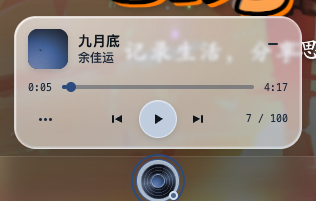
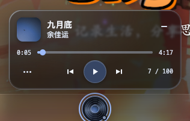

# 网抑云 · Halo 插件

网抑云为 Halo 提供基于 Folia Web 的独立音乐页。访问 `/music` 浏览公开歌单、搜索和试听，绑定网易云账号后可使用个人曲库。

**Halo 2.27.0+** · [下载 JAR](https://github.com/sky121666/halo-plugin-ncm/releases) · [使用文档](docs/站点管理.md) · [问题反馈](https://github.com/sky121666/halo-plugin-ncm/issues)

## 安装与快速开始

1. 下载 `plugin-ncm-*.jar`，在 Halo 控制台「插件」中上传并启用。
2. 打开站点的 `/music` 搜索和试听。插件会自动初始化游客会话。

游客及未绑定用户使用游客权限，绑定后按本人账号权限播放。完整播放、试听和音质以网易云返回为准。

## 站点小播放器

**默认关闭。** 保持音乐页开启，在「工具 → 网抑云 → 精选歌单」发布游客可访问的歌单。点击对应歌单行的「配置小播放器」，开启「在主题页面显示小播放器」并保存。

  
  

启用后，首页、文章等主题页面显示可拖动的黑胶入口。普通主题和 Swup 主题都由 Folia 播放，点击封面、歌名或歌手可进入当前歌曲的歌词页。

| 实际导航方式 | 播放行为 |
| --- | --- |
| 整页跳转或刷新 | 恢复公开队列、曲目和进度。开启自动续播后会尝试继续播放。浏览器要求交互时，点播放继续。 |
| Swup 或 PJAX 仅替换博客正文 | 当前文档内保留音频。挂载元素随正文替换时，播放器界面自动重新挂载。 |
| 同一标签页内在博客与 `/music` 间切换 | **无缝续播需要主题适配 Swup 4**。适配后博客和音乐页共用同一个 Folia 播放引擎。 |

- **Swup 4 接入**　初始化后派发 `ncm:swup-ready` 提供现有实例，收到 `ncm:request-swup` 时再次派发。自定义导航钩子识别 `visit.meta.ncmMusic` 并保留主题容器。 [接入代码与验收方法](docs/站点小播放器接入.md#swup-4-共用-folia-引擎)
- **位置与配色**　主题可用 `<ncm-mini-player>` 自定义挂载位置，通过 `data-color-scheme` 同步亮暗，使用 `--ncm-player-accent` 接入主题主色。 [挂载与配色说明](docs/站点小播放器接入.md#主题作者接入)

## 使用与开发

- **个人曲库**　从音乐首页或「音质」面板登录 Halo，再扫码绑定网易云。进入 `/music/library` 查看歌单、喜欢的歌、收藏和播放记录。解绑入口在「个人中心 → 网抑云」。
- **站点管理**　在「工具 → 网抑云」设置音乐页、精选歌单、小播放器和账号。歌词分词与歌曲配色可接入 AI Foundation，并按 Halo 角色开放。 [管理入口与排障](docs/站点管理.md)
- **配置同步**　登录用户默认同步个人偏好，超级管理员可发布站点默认。歌词、封面和歌曲缓存留在当前浏览器。 [配置同步接入](docs/配置同步快速接入.md)
- **主题与 API**　提供文章音乐卡片、`ncmFinder` 和按权限调用的 HTTP 接口。 [接口与权限](docs/开发与接口.md)
- **本地构建**　使用 JDK 21、Node.js 24 和 pnpm 10 运行 `./gradlew build`，JAR 位于 `build/libs/`。 [开发调试与发布](docs/构建与发布.md)

## 开源来源与许可

- 音乐页、播放器和歌词界面。 [Folia Web](https://github.com/folia-ce/folia-web/tree/095e7f84738e1a366be2dc0fec3960cbac1793dd) · [AGPL-3.0](licenses/folia-web.AGPL-3.0.txt)
- 网易云请求协议与 Java 接口移植参考。 [NeteaseCloudMusicApiEnhanced](https://github.com/NeteaseCloudMusicApiEnhanced/api-enhanced/tree/v4.41.1) · [MIT](licenses/api-enhanced.MIT.txt)
- 插件运行平台、开发工具和组件。 [Halo](https://github.com/halo-dev/halo) · [GPL-3.0](https://github.com/halo-dev/halo/blob/main/LICENSE)
- 扫码绑定的二维码渲染。 [node-qrcode](https://github.com/soldair/node-qrcode/tree/v1.5.4) · [MIT](licenses/node-qrcode.MIT.txt)

插件自有后端与管理端采用 MIT，Folia Web 衍生前端采用 AGPL-3.0。第三方许可证随 JAR 分发，前端适配源码和构建说明可从音乐页「设置 → 帮助 → 开源项目」获取。 [插件许可证](LICENSE)
